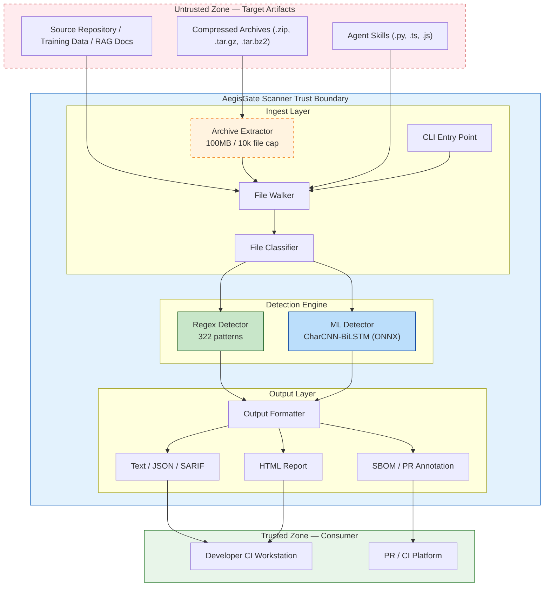

# AegisGate Scanner — Threat Model and Security Scope

> **Document status:** Audit-ready  
> **Version:** 1.0  
> **Last updated:** 2026-10-12  
> **Classification:** Internal — Engineering & Security  
> **Source references:**  
> - Platform DFD: `aegisgate-platform/docs/diagrams/threat-model-dfd.mmd`  
> - Platform taxonomy: `aegisgate-platform/upstream/aegisgate/pkg/opsec/threat_model.go`  
> - OWASP STRIDE reference: `aegisgate-lens/corpora/…/STRIDE.md`  

---

## 1. Purpose and Scope

AegisGate Scanner is a CLI-based static analysis tool that inspects AI/ML
artifacts — training data, RAG documents, model configuration files, and agent
skills — for security and compliance risks before they enter production
pipelines. It combines regex-based pattern matching with an ML-based prompt
injection detector (CharCNN-BiLSTM) to provide layered defense.

This document defines the threat model for Scanner itself: its attack surface,
the threats it is designed to detect in target artifacts, the threats it does
not cover, and the assumptions that underpin its guarantees.

### 1.1 System description

Scanner operates as a single-process CLI tool. It reads files from the local
filesystem or stdin, classifies each file by artifact type, applies regex and
ML detectors, and writes findings to stdout or structured output formats
(JSON, SARIF, HTML, SBOM). No network calls are made during a scan.

---

## 2. Architecture and Data Flow

### 2.1 Pipeline overview

```
CLI → Walker → Classifier → Regex Detector → ML Detector → Output Formatter
         ↓          ↓            ↓               ↓
    Archive      Artifact     Pattern         ONNX
    Extraction   Class        Match           Inference
```

| Stage            | Package                        | Responsibility |
|------------------|--------------------------------|----------------|
| CLI              | `cmd/aegisgate-scanner`        | Parse flags, orchestrate scan, render output |
| Walker           | `pkg/artifacts/walker.go`      | Traverse filesystem, respect `.gitignore`, stream file contents |
| Archive Extract  | `pkg/artifacts/archive.go`     | Decompress `.zip`, `.tar.gz`, `.tar.bz2` into temp dir with size/file limits |
| Classifier       | `pkg/artifacts/walker.go`      | Classify each file as `rag-document`, `training-data`, `model-config`, `agent-skill`, or `generic` |
| Regex Detector   | `pkg/detectors/engine.go` | Pattern-match secrets, PII, XSS, compliance, dangerous functions, OT/ICS |
| ML Detector      | `internal/ml/detector.go`      | CharCNN-BiLSTM inference for prompt injection (ONNX runtime) |
| Output Formatter | `pkg/output`                   | Emit findings as text, JSON, SARIF, HTML, SBOM, or PR annotation |

### 2.2 Mermaid DFD with trust boundaries



**Trust boundary notes:**
- The **Untrusted Zone** contains all target artifacts. Scanner treats every
  file as adversarial — no file is trusted based on path, extension, or source.
- The **Scanner Trust Boundary** encompasses all processing. File contents
  never leave the process; no telemetry, no network egress.
- The **Trusted Zone** is the consumer of scan output. Output formats are
  generated with content escaping to prevent injection in downstream tools.

---

## 3. STRIDE Analysis

| STRIDE category | Applicable to Scanner? | Description |
|-----------------|------------------------|-------------|
| **Spoofing** | Partial | Scanner does not authenticate users; it is a CLI tool run by a developer. Spoofing risk is limited to a malicious actor modifying the scanner binary or model file (addressed via supply chain controls). |
| **Tampering** | Yes | An attacker could tamper with target artifacts to evade detection (obfuscation, Unicode normalization tricks) or tamper with the scanner binary itself. |
| **Repudiation** | Low | Scanner produces SARIF and JSON outputs with timestamps for audit trails. CI integration provides pipeline-level non-repudiation. |
| **Information Disclosure** | Yes | Scanner reads file contents that may contain secrets or PII. Findings output includes matched text snippets (truncated to 200 chars). Risk: sensitive data in scan reports. |
| **Denial of Service** | Yes | Archive bombs, pathologically large files, or deeply nested directories could exhaust memory/disk. Mitigated by extraction caps and file-size limits. |
| **Elevation of Privilege** | Partial | Archive traversal attacks (zip-slip) could write files outside the temp directory, potentially achieving code execution on the build host. |

---

## 4. Threat Actors

| Actor | Motivation | Capability | Likelihood |
|-------|-----------|------------|------------|
| **Malicious insider** with access to training data | Embed backdoors or biases in ML pipelines | Can modify training datasets, RAG docs, or model configs before scan | Medium |
| **External attacker** publishing poisoned content | Inject prompt payloads into public datasets or packages | Publishes malicious content to HuggingFace, npm, PyPI, or public RAG sources | Medium |
| **Careless developer** committing secrets | No malicious intent; accidental exposure | Commits API keys, tokens, PII to repos that feed training pipelines | High |
| **Supply chain attacker** modifying dependencies | Compromise scanner itself via malicious Go modules or ONNX runtime | Can inject malicious code into build or alter model weights | Low |

---

## 5. In-Scope Threats

These are the threats Scanner is designed to detect in target artifacts.

| ID | Threat | STRIDE | OWASP LLM | Severity | Detection |
|----|--------|--------|-----------|----------|-----------|
| S-001 | **Prompt injection in text artifacts** — adversarial instructions embedded in RAG docs or training data | Tampering | LLM01 | High | Regex detector (322 patterns) + ML detector (CharCNN-BiLSTM ONNX inference) |
| S-002 | **Secrets in source/config files** — API keys, tokens, cloud credentials committed to repositories | Info Disclosure | LLM06 | Critical | Regex detector: 64 credential patterns (AWS, GCP, Azure, GitHub, Slack, etc.) |
| S-003 | **PII in training data / RAG docs** — SSNs, phone numbers, email addresses, financial data | Info Disclosure | LLM06 | High | Regex detector: US core, US extended, financial, international PII patterns |
| S-004 | **Dangerous functions in agent skills** — `eval()`, `exec()`, `os.system()`, `subprocess(shell=True)` in `.py`/`.ts`/`.js` | Elevation of Privilege | LLM02 | Critical | Regex detector: dangerous function pattern set |
| S-005 | **Compliance violations** — GDPR, HIPAA, PCI-DSS indicator patterns in artifacts | Info Disclosure | LLM06 | High | Regex detector: 64 compliance patterns (incl. 17 prompt injection) |
| S-006 | **XSS in HTML artifacts** — `<script>` injection, event handlers, `javascript:` URIs | Tampering | LLM02 | Medium | Regex detector: 12 XSS patterns |
| S-007 | **Archive-based attacks** — decompression bombs, path traversal (zip-slip), symlink loops | DoS / Elevation | — | High | Archive extractor: 100MB extraction cap, 10,000 file limit, path traversal validation, symlink rejection |
| S-008 | **OT/ICS protocol exposure** — industrial control system protocol references in configs | Info Disclosure | — | Medium | Regex detector: 9 OT/ICS protocol patterns |

---

## 6. Out-of-Scope Threats

Scanner does **not** detect or mitigate the following. These are documented
to set explicit expectations for downstream consumers.

| ID | Threat | Rationale |
|----|--------|-----------|
| O-001 | **Model weight poisoning** | Scanner analyzes text artifacts, not binary model weights. ONNX model integrity is a supply-chain concern (see O-005). |
| O-002 | **Adversarial images** | Scanner processes text only. Multimodal adversarial inputs (images, audio) are outside detection capability. |
| O-003 | **Runtime LLM behavior** | Scanner is a static analysis tool. It does not observe model inference at runtime or detect real-time jailbreaks. |
| O-004 | **Network-level attacks** | Scanner makes no network calls. Network security is the responsibility of the host environment and CI infrastructure. |
| O-005 | **Access control** | Scanner does not enforce RBAC or authentication. It assumes the operator has legitimate access to target files. |
| O-006 | **Encryption at rest** | Scanner reads plaintext files. Encryption of artifacts is the responsibility of the storage layer. |

---

## 7. Mitigation Mapping

Each in-scope threat and its mitigation within Scanner's architecture:

| ID | Mitigation |
|----|------------|
| **S-001** | **Regex (223+ patterns)** covering direct injection, role hijacking, encoded payloads. **ML (CharCNN-BiLSTM)** catches novel injection semantically. **Text normalization** — Unicode confusable decomposition, homoglyph mapping, zero-width stripping — applied before both layers to defeat evasion. OWASP: LLM01. |
| **S-002** | **Regex (64 credential patterns)** for AWS, GCP, Azure, GitHub, Slack, Stripe, DB strings, private keys, JWTs. **Matched text truncated to 200 chars** to avoid reproducing full secrets in reports. OWASP: LLM06. |
| **S-003** | **Multi-jurisdiction PII regex:** US core (SSN, phone, email), US extended (license, passport), financial (cards, bank accounts), international (GDPR EU patterns). OWASP: LLM06. |
| **S-004** | **Dangerous function regex** for Python (`eval`, `exec`, `os.system`, `subprocess(shell=True)`), TS/JS (`eval`, `child_process`, `Function()`). Scoped to `agent-skill` class files only to reduce false positives. OWASP: LLM02. |
| **S-005** | **47 compliance patterns + 17 prompt injection = 64 total** for GDPR, HIPAA, PCI-DSS indicators. **SARIF export** for compliance dashboards and audit pipelines. |
| **S-006** | **12 XSS patterns** for `<script>` tags, event handlers, `javascript:` URIs. **HTML output escaping** — all finding content is HTML-escaped to prevent injection in generated reports. |
| **S-007** | **Decompression bomb caps:** `MaxExtractionSize` (100 MB), `MaxExtractedFiles` (10,000). **Path traversal:** `filepath.Clean()` + root-bound check; `../` entries rejected. **Symlinks:** symbolic links within archives are skipped entirely. |
| **S-008** | **9 OT/ICS patterns** detecting Modbus, DNP3, OPC-UA, S7comm, and other industrial protocol references in configuration files. |

---

## 8. Known Limitations

| Limitation | Description | Impact |
|-----------|-------------|--------|
| **Indirect prompt injection** | Scanner detects injection per-file but cannot model multi-file or multi-turn chains where payloads are split across artifacts. | Advanced indirect injection spanning files may be missed. |
| **Multimodal artifacts** | Scanner processes text only — no image, audio, or video analysis. | Adversarial content in non-text modalities goes undetected. |
| **Model weight analysis** | No inspection of ONNX, Safetensors, or PyTorch binary weight files for backdoors. | Compromised model weights pass through undetected. |
| **Novel obfuscation evasion** | Text normalization covers Unicode confusables and zero-width chars, but novel encoding (Base64 in-flight, custom ciphers) may bypass both layers. | Zero-day evasion has a detection gap until patterns are updated. |
| **Single-file context** | Files are analyzed independently. Cross-file data flow (e.g., secret in file A used in file B) is not tracked. | Multi-file contextual risks are not detected. |

---

## 9. Assumptions and Dependencies

### 9.1 Assumptions

1. **Operator trust:** The individual running Scanner has legitimate access to target files and the build environment.
2. **Filesystem integrity:** The host filesystem is not compromised at scan time. Scanner does not defend against a malicious kernel or root-level adversary.
3. **Plaintext access:** Target artifacts are readable as plaintext. Scanner does not decrypt encrypted files or deobfuscate binary-encoded content beyond archive extraction.
4. **Model integrity:** The ONNX model file bundled with Scanner is trusted. Scanner does not self-verify model weights at runtime.
5. **CI environment:** When integrated into CI pipelines, the pipeline platform (GitHub Actions, GitLab CI) provides its own access control and network isolation.

### 9.2 Dependencies

| Dependency | Version constraint | Trust level | Notes |
|-----------|-------------------|-------------|-------|
| Go standard library | Go 1.22+ | High | `archive/zip`, `archive/tar`, `compress/gzip`, `compress/bzip2` for archive extraction |
| ONNX Runtime (CGO) | Bundled `lib/` per arch | Medium | Native library; integrity verified via Go module checksum + reproducible build |
| Go modules | `go.sum` pinned | Medium | Vulnerability scanning via `govulncheck` in CI |
| Text normalization tables | Unicode 17.0.0 | High | Embedded in `internal/textnorm/norm/tables17.0.0.go` |

### 9.3 Environmental requirements

- **No network access required:** Scanner operates fully offline — no telemetry, no model downloads, no API calls.
- **Temporary directory:** Archive extraction requires writable temp space of at least `MaxExtractionSize` (100 MB). Cleaned up after each scan.
- **Memory:** ML inference requires ~50 MB resident memory for the ONNX model. Regex scanning is streaming and bounded by per-file size limits.

---

## 10. Threat Vector Taxonomy (Reference)

The following taxonomy is adapted from the AegisGate Platform threat model
(`pkg/opsec/threat_model.go`) and mapped to Scanner's coverage:

| Threat vector | Platform ID | Scanner coverage |
|--------------|-------------|-----------------|
| `prompt_injection` | T001, T002 | **In-scope** (S-001) — regex + ML detection |
| `data_exfiltration` | T003 | **In-scope** (S-002, S-003) — secrets and PII detection |
| `model_theft` | T004 | **Out-of-scope** (O-001) — no weight analysis |
| `training_poisoning` | T005 | **Partial** — Scanner detects text-level poisoning indicators but not statistical anomalies in weights |
| `adversarial_input` | T006 | **In-scope** (S-001) — text normalization + ML detector |
| `shadow_ai` | T007 | **Out-of-scope** — Scanner does not monitor network egress or API usage |
| `supply_chain` | T008 | **Out-of-scope** (O-005) — dependency integrity is a CI/CD concern |
| `privilege_escalation` | T009 | **In-scope** (S-004, S-007) — dangerous functions + archive traversal |
| `denial_of_service` | T010 | **In-scope** (S-007) — archive bomb caps and file limits |
| `side_channel` | T011 | **Out-of-scope** — Scanner is not a networked service |

---

## 11. Review and Maintenance

| Item | Schedule |
|------|----------|
| Threat model review | Quarterly or upon major architecture change |
| Pattern set update | Monthly or upon new OWASP LLM Top 10 release |
| ML model retraining | When evasion rate exceeds 5% on adversarial test suite |
| Dependency audit | Weekly via `govulncheck` in CI |

---

*End of document.*